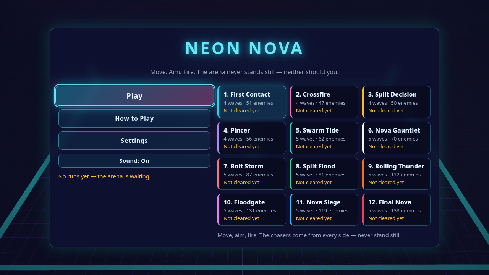
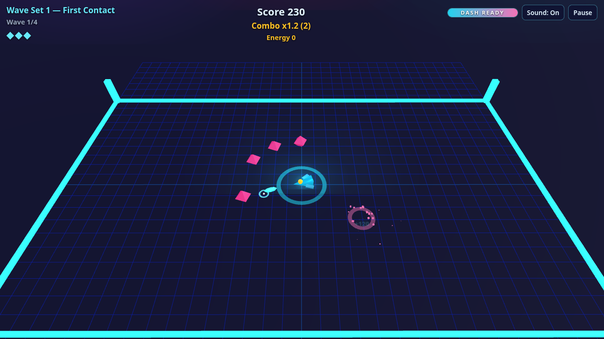
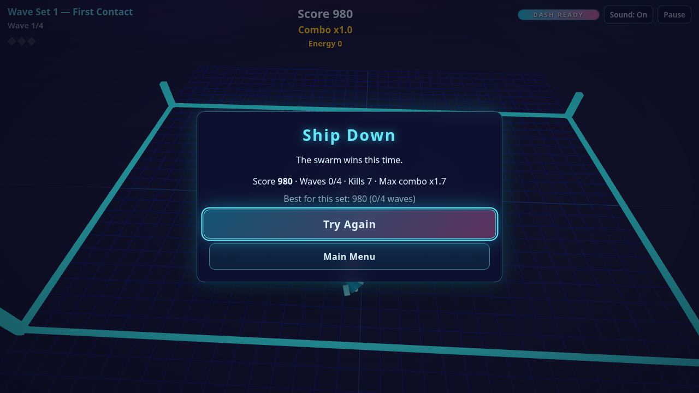

# Neon Nova

A 3D neon arena shooter — **move, aim, fire**. Pilot a ship in a bounded
neon arena, destroy waves of enemies, dash through danger, and chain
kills into a combo. Chasers fly straight at you, shooters hold their
distance and fire bolts, splitters burst into minis when they die. You
have 3 shields: a hit costs one and stuns the ship; lose all three and
the run ends. Clear every wave to finish the set. Score comes from kills
× combo multiplier + wave bonuses — your best score is saved per wave set.
Enemies drop gold energy: spend it on ship upgrades, play all 12 sets in
a row in Campaign, or see how deep you can go in endless Survival.

**Live:** https://namdev-muse.github.io/neon-nova/
**Version:** v0.4.0 (M4 progression & depth)
**Stack:** Three.js 0.160.0 (pinned via jsdelivr import map, no build step), vanilla HTML/CSS/JS, Web Audio synth SFX + generative music, GitHub Pages.

## Gameplay

Real captures from a headless-Chromium run of the game
(`npm run screenshots` regenerates them — see `tests/screenshots.js`).





## The core: aim + positioning is the skill

The ship flies freely in a bounded arena and only you move it — there
is no auto-aim, no auto-fire, no assist. Movement has momentum and the
ship banks into its strafe, so you steer early and commit. Your shots go
exactly where the crosshair points. Dash (Shift) bursts through danger
with a short cooldown and a moment of invulnerability — spend it when
the swarm closes in. Standing still is how you die: enemies spawn on a
ring around the ship and close from every side, faster than one aim line
can kill them. The bot harness proves it — the greedy combat bot
completes all 12 wave sets, while sitting still and holding fire fails
all 12.

## Feel & juice

Every combat event fires a full layered bundle in one frame — sound,
particles, shake, flash, knockback, hit-stop, slow-mo, FOV pulse,
number pops — per the game-feel tiers (small / medium / large). Kills
burst into particles and a shockwave ring with a score pop; taking a hit
shakes the camera, flashes the screen, squashes the ship and knocks it
back, with a hit-stop freeze and slow-mo on the last shield. The camera
follows the ship, leans toward your aim, and widens its field of view
as you fly faster. The generative soundtrack layers a bass line, a pad
and — from wave 2 on — a lead arpeggio; on the last shield a slow red
vignette breathes at the edges and a soft heartbeat thumps. Shake
strength (0–100%), flashing, volume, music and SFX are all adjustable
in Settings, and every effect settles back to its exact rest state.

## Progression & depth

- **Campaign:** all 12 wave sets in a row, one run. Score, energy and
  upgrades carry across sets; shields refill between sets; death ends
  the campaign (your best campaign total is kept). Quitting to the menu
  keeps the campaign — resume it any time.
- **Ship upgrades:** gold energy is currency. Between campaign sets, and
  every 3 waves survived, choose from three upgrade cards — Rapid Fire,
  Twin Shot, Heavy Rounds, Reinforced Hull, Dash Recharge, Magnet Core —
  each with levels that genuinely change how the ship flies and shoots.
  Everything costs 163 energy in total, and one campaign earns roughly
  150–200, so a build is a choice, not a checklist.
- **Survival:** endless escalating waves — shooters join from wave 2,
  splitters from wave 3, and the pressure never stops. The wave bonus
  grows as you go deeper. A stationary ship dies in wave 2; a stock ship
  lasts about 9 waves, a well-upgraded one past 17.
- **Unlocks:** clearing a set unlocks the next one; clearing Set 1
  unlocks Survival. The combo window is 2.5s — kills must come close
  together to hold the multiplier at x4.

Twelve hand-crafted wave sets, each with its own identity (palette, enemy
mix, spawn rhythm):

| # | Wave set | Identity |
|---|----------|----------|
| 1 | First Contact | Chasers only at first — move, aim, fire; shooters join late |
| 2 | Crossfire | Shooters hold their distance and fire bolts |
| 3 | Split Decision | Splitters burst into minis — kill them where you have room |
| 4 | Pincer | Everything at once, from both flanks |
| 5 | Swarm Tide | The tide does not stop — thin the swarm, chain the combo |
| 6 | Nova Gauntlet | Everything you learned, all at once |
| 7 | Bolt Storm | Shooter-heavy — bolts from every angle, never stop moving |
| 8 | Split Flood | Splitter-heavy — every kill doubles the trouble |
| 9 | Rolling Thunder | Staggered waves with no pause — find the rhythm and ride it |
| 10 | Floodgate | Chaser floods in rolling waves — thin the flood before it reaches you |
| 11 | Nova Siege | A siege in five acts — everything at once, and then more of it |
| 12 | Final Nova | The final nova — the hardest set, everything at its peak |

## Controls

- **WASD / arrows:** move (momentum + banking)
- **Mouse:** aim — **Click / Space:** fire
- **Shift:** dash (cooldown + brief invulnerability)
- **P:** pause — **M:** mute — **R:** restart
- **Touch:** left stick moves, drag right side to aim and fire, DASH button dashes

## Development

```sh
npm test            # smoke tests + bot harness (Node, no browser)
npm run render-check  # headless Chromium: menu, movement, screen-space aim, firing, dash, kill, wave clear, shield loss, run-over
npm run screenshots   # README captures + 3-resolution size sweep (inspect by eye)
```

## Tests

- **Smoke (289 checks):** wave sets, movement momentum, aim, fire rate,
  dash, kills/combo/score, splitters, shooter bolts, shield loss,
  wave flow, determinism, the anti-slop gate, feedback tiers + layers,
  upgrades (table, derived stats, purchases), survival wave generation
  and escalation, unlock gates, save round-trip (incl. campaign +
  survival bests).
- **Bot:** the greedy combat bot (kites, leads its aim, dodges bolts,
  dashes out of crushes) completes all 12 wave sets; sitting still and
  holding fire fails all 12. A mid-campaign loadout clears set 12 with
  shields to spare, survives 17 survival waves (vs 9 stock), and a
  stationary ship dies in survival wave 2.
- **Render check:** headless Chromium — menu over a live 3D attract
  scene, Play starts a run, movement and aim asserted in *screen* space,
  firing, dash, kill, wave-1 clear, shield loss with the flashing
  toggle, pause/resume/restart, run-over, best score saved — plus the
  M3 feel assertions: every feedback bundle fires completely (read back
  from the in-game feedback log), speed FOV kick and settle, rest-state
  cleanliness, shake-0 suppression, low-shield vignette — plus the M4
  progression assertions: fresh-save gates (sets 2–12 and Survival
  locked), a full campaign clear of set 1 opening the upgrade screen,
  buying a card spending energy and applying the upgrade, continuing
  into set 2 with the loadout, the gates opening afterwards, and a
  Survival run clearing wave 1 without ending — zero console errors.
